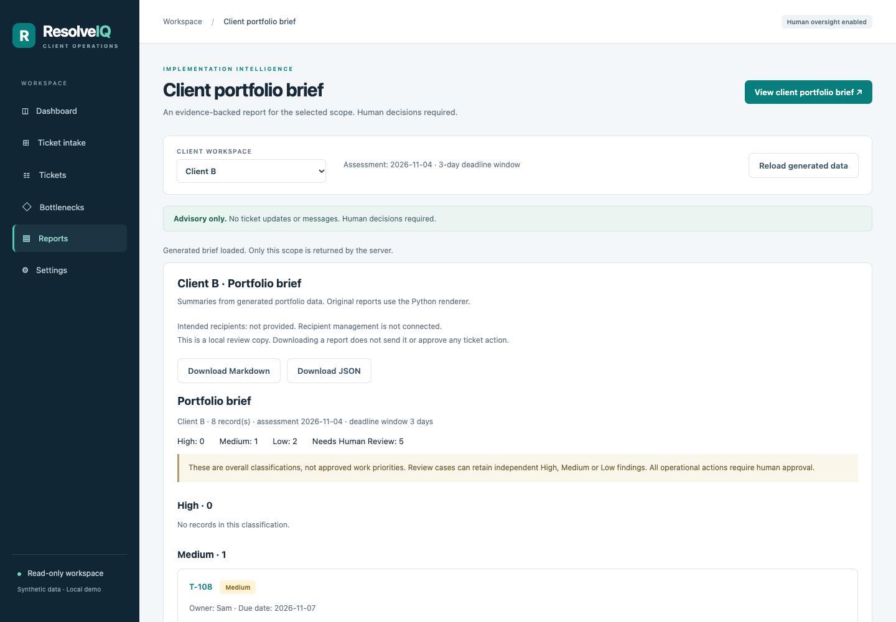

# ResolveIQ

## Problem

Implementation managers and client operations teams often manage multiple tickets across different clients, making it difficult to identify missing information, approaching deadlines, unresolved blockers, and operational risks before they disrupt delivery. These gaps can delay client go-lives and erode trust.

## Solution

ResolveIQ helps implementation managers monitor client projects, identify operational risks, and prepare clear, evidence-based reports so teams can address problems before they disrupt delivery.

ResolveIQ addresses this challenge by validating ticket information, identifying evidence-based risks, and generating client-specific portfolio briefs that help teams prioritize human review.

By bringing these findings into one place, ResolveIQ helps implementation teams make more informed decisions while keeping final approvals, escalations, and communications under human control.

ResolveIQ is a Python decision-support prototype for reviewing a batch of tickets
and turning their recorded facts into a portfolio brief for each client. Its
current workflow is deterministic and uses Python's standard library; no LLM,
API key, or live service connection is needed to run the synthetic-data demo.

The project was inspired by the operational responsibilities in
[Gradient AI's Program Operations Specialist job description](https://job-boards.greenhouse.io/gradientai/jobs/8034609003),
including client portfolio tracking, cross-team coordination, and reporting on
timelines, dependencies, risks, and bottlenecks. ResolveIQ explores a possible
improvement to that work. The problem statement is a project hypothesis, not a
confirmed account of Gradient AI's internal processes. ResolveIQ is an
independent project and is not affiliated with Gradient AI.

1. **Normalize** supported source records without filling in missing information.
2. **Validate** required fields and defined contradictions.
3. **Assess risk** with an explicit date and evidence-backed rules.
4. **Build client briefs** containing classifications, findings, source evidence,
   and items needing human review.

The shared branch includes normalization, validation, risk assessment, portfolio
brief generation, a command-line reporting runner, and a local browser dashboard.
The [walkthrough and sample brief](https://github.com/Michelle-Sainsbury/resolveiq/pull/7)
and the [dashboard](https://github.com/Michelle-Sainsbury/resolveiq/pull/8) are
merged into `feature/resolveiq-build`.

## How ResolveIQ Handles Ticket Data

The command-line runner loads tickets from a JSON file containing an array.
The dashboard can preview synthetic JSON or CSV, and the library provides
normalization adapters for CSV text and supported GitHub issue records supplied
by a separate reader. ResolveIQ does not retrieve GitHub issues through a live API.

Normalization and validation check whether required ticket information is
missing, invalid, or contradictory. When those checks flag a ticket, its overall
classification is **Needs Human Review**, even if there is also evidence that it
is overdue or blocked. ResolveIQ preserves missing information and the evidence
it has without guessing values. For example, an empty dependency list confirms
that none are listed; a null list means the information is unknown. The checks
apply to required fields on the normalized ticket, not arbitrary source metadata.

## Features

- **Ticket Validation:** Identifies missing or incorrectly formatted information
  so managers know which records need correction or review.
- **Risk Signals:** Highlights overdue deadlines, recorded blocked work,
  and approaching due dates so teams can focus their review on supported risk
  signals. It does not automatically rank work or decide operational priorities.
- **Dependency Review:** Flags unknown, malformed, duplicate, or self-referencing
  dependency information for investigation. References alone do not establish
  whether a dependency exists, is unresolved, or is causing a blocker.
- **Client Portfolio Reporting:** Generates client-specific summaries showing
  recorded ticket status, risk levels, and supporting evidence.
- **Human Review and Oversight:** Identifies situations requiring human judgment
  and preserves supporting information so managers can make informed decisions
  before taking action.

The library includes adapters for decoded JSON, CSV text, and Cycle 2 GitHub
reader dictionaries. The reporting runner reads a **JSON array**; it does not
fetch GitHub issues or accept CSV files directly.

## Tech Stack

| Technology | Purpose and scope |
| --- | --- |
| **Python 3** | Core application logic, ticket validation, risk assessment, and portfolio reporting. Verified here with Python 3.9.6. |
| **Python standard library** | `json` and `csv` handle source records; `datetime` supports calendar-date calculations; built-in data structures and `copy` preserve structured evidence. No third-party Python runtime packages are required. |
| **GitHub Issues data adapter** | Normalizes supported Cycle 2 reader dictionaries through `normalize_github_issue`. The adapter does not independently call the live GitHub API. |
| **HTML, CSS, JavaScript** | Local browser dashboard included in `feature/resolveiq-build`. |
| **Python unittest** | Automated validation, normalization, risk, portfolio, and runner tests. |
| **Playwright** | Browser-test tooling on the shared branch, using Node.js and an installed Chrome executable. Optional dashboard development tooling; not required for the command-line demo. |
| **Git and GitHub** | Version control, descriptive commits, pull requests, and collaborative review. |
| **OpenAI Codex** | Assisted Michelle with development, documentation, and code review. Development tooling only. |
| **Claude Code** | Assisted Huma with portfolio reporting, runner development and tests, and the walkthrough. Claude co-authorship is recorded in [PR #5](https://github.com/Michelle-Sainsbury/resolveiq/pull/5), [PR #6](https://github.com/Michelle-Sainsbury/resolveiq/pull/6), and [PR #7](https://github.com/Michelle-Sainsbury/resolveiq/pull/7) commit history. Development tooling only. |

**Current risk classification is deterministic and rule-based, not powered by a
live AI model.** The synthetic-data workflow needs no LLM service or API key.

## Contributions

ResolveIQ is a collaborative project by **Michelle Sainsbury and Huma Ali**.

- **Michelle Sainsbury:** Led ticket validation and risk assessment
  ([PR #2](https://github.com/Michelle-Sainsbury/resolveiq/pull/2)), normalization
  and review gating ([PR #3](https://github.com/Michelle-Sainsbury/resolveiq/pull/3)),
  and dashboard implementation and usability refinements
  ([PR #8](https://github.com/Michelle-Sainsbury/resolveiq/pull/8)). She also
  reviewed and tested shared changes, identifying a runner defect where a report
  could overwrite the input ticket file.
- **Huma Ali:** Led synthetic fixtures and expected results
  ([PR #4](https://github.com/Michelle-Sainsbury/resolveiq/pull/4)), evidence-preserving
  portfolio reporting ([PR #5](https://github.com/Michelle-Sainsbury/resolveiq/pull/5)),
  the reporting runner, the input/output collision fix, and its regression tests
  ([PR #6](https://github.com/Michelle-Sainsbury/resolveiq/pull/6)), and the walkthrough
  and sample brief ([PR #7](https://github.com/Michelle-Sainsbury/resolveiq/pull/7)).
  She tested the reporting workflow and documented its limitations.

Huma reviewed the validation and normalization PRs. GitHub's merge records
show that Michelle merged PRs #1–#6, and Huma merged PRs #7 and #8 with
Michelle's authorization. Merge attribution identifies who performed the merge,
not necessarily who authored the implementation. The linked PRs retain the
implementation, test, and review history.

## Setup

Verified on macOS with Python **3.9.6**. Requirements:

- Python 3 and Git installed.
- Authorized repository access while the repository is private. Configure SSH
  access or HTTPS authentication before cloning; no credentials belong in files.
- No third-party Python packages are required.

Using an existing authorized SSH key:

```sh
git clone git@github.com:Michelle-Sainsbury/resolveiq.git
cd resolveiq
git switch feature/resolveiq-build
```

With HTTPS authentication already configured, the clone URL is
`https://github.com/Michelle-Sainsbury/resolveiq.git`. In an existing clone,
check for local work before changing branches. `main` currently does not contain
the implementation described here.

Run the following commands from the repository root, which contains `scripts/`,
`resolveiq/`, `data/`, and `tests/`.

## Demo

**No installation needed:** [Read the sample portfolio brief](docs/sample/brief.md)
from PR #7. See the [synthetic-data walkthrough](docs/walkthrough.md) for the
full CLI demonstration. Repository access is required while the project is private.

### Dashboard screenshot



Huma uploaded the ResolveIQ video demonstration on November 9, 2026. A
screenshot was captured from that demonstration on November 10, 2026 for the
Pursuit platform lesson. The dashboard originated on `michelle/dashboard` and
is now included in `feature/resolveiq-build`.
Client B has eight tickets: 0 High, 1 Medium, 2 Low, and 5 needing human review.
The capture predates a display refinement that adds ticket titles to the cards.

### Run the browser dashboard

From the repository root:

```sh
PYTHONDONTWRITEBYTECODE=1 python3 scripts/serve_dashboard.py --date 2026-11-04
```

Open http://127.0.0.1:8787 and select a client. The dashboard uses generated
brief data and provides client-scoped ticket details, evidence, JSON/CSV intake
previews, and report viewing and downloads. It does not change source tickets or
send messages. See the [dashboard guide](docs/dashboard.md) for setup, browser
checks, and limitations.

### Run the command-line demo

The demo uses the repository's **20 synthetic tickets**, assessed on **November 4,
2026**, with the default **three-day** deadline window. It requires no live data.

On macOS/zsh, create a fresh temporary output folder and run:

```sh
resolveiq_demo_dir="$(mktemp -d)"
PYTHONDONTWRITEBYTECODE=1 python3 scripts/run_brief.py \
  --date 2026-11-04 --out "$resolveiq_demo_dir"
printf 'Reports: %s\n' "$resolveiq_demo_dir"
```

Open `brief.md` in that folder with a text editor. `brief.json` contains the
structured report, including full records and provenance. The date must be
provided explicitly; the runner never substitutes today's date.

Verified results for this dataset and assessment date:

| Scope | High | Medium | Low | Needs Human Review | Total |
| --- | ---: | ---: | ---: | ---: | ---: |
| Client A | 2 | 1 | 4 | 3 | 10 |
| Client B | 0 | 1 | 2 | 5 | 8 |
| Client C | 0 | 0 | 1 | 0 | 1 |
| Batch review queue | 0 | 0 | 0 | 1 | 1 |
| **Overall** | **2** | **2** | **7** | **9** | **20** |

Examples worth inspecting:

- **T-101:** High because its status is blocked; a separate Medium finding
  records that its deadline is two days away.
- **T-106:** Needs Human Review because its owner is null, while its overdue High
  finding remains visible. This explains why Client B's primary High count is zero.
- **T-114:** Needs Human Review because blocked status conflicts with an empty
  dependency list; the supported blocked High finding is retained.
- **T-111:** Missing client ID sends the record to the batch review queue rather
  than an assumed client.

To use another approved synthetic JSON batch:

```sh
PYTHONDONTWRITEBYTECODE=1 python3 scripts/run_brief.py \
  --date 2026-11-04 --tickets /path/to/synthetic-tickets.json \
  --out /path/to/new-report-directory
```

Replace the example paths before running. The runner creates the output directory
if needed and overwrites existing `brief.json`/`brief.md` reports there. It refuses
input/output collisions, including symlinks and hard links, to protect the input.
Exit codes are `0` for success, `1` for unusable input/output, and `2` for invalid
command-line arguments.

## Repository Structure

The project is organized as follows:

| Path | Purpose |
| --- | --- |
| `resolveiq/` | Python package containing validation, normalization, risk assessment, and portfolio-brief functions. |
| `scripts/` | Command-line reporting runner and local dashboard server. |
| `dashboard/` | Browser interface and styling. |
| `docs/` | Walkthrough, sample brief, dashboard guide, and screenshot. |
| `data/tickets/` | Controlled synthetic JSON ticket inputs. |
| `data/expected/` | Development-set expected outcomes, kept separate from source tickets. |
| `tests/` | Automated Python and browser regression checks. |
| `docs/images/` | The verified dashboard screenshot embedded in this README. |
| `README.md` | Project overview, demonstration, setup, tests, limitations, and technical reference. |
| `.gitignore` | Excludes local environment files, Python bytecode/cache files, and other generated artifacts. |

### Commit history

Recent descriptive commits include `3392a2a` (dashboard usability and evidence
navigation), `63fd635` (walkthrough access and limitations), and `e511ace`
(runner input/output collision fix). Merge commits identify the pull request
and source branch.

## Testing

Run the complete suite from the repository root:

```sh
PYTHONDONTWRITEBYTECODE=1 python3 -m unittest discover -s tests -v
```

Verification on macOS with Python 3.9.6 against the shared implementation at
`482cb7ea1bb6a1ca158acbfa9ffb1df6e2e21efd`:

| Area | Checks passed |
| --- | ---: |
| Validation | 14 |
| Risk assessment | 15 |
| Normalization | 22 |
| Portfolio brief | 43 |
| Reporting runner | 21 |
| Dashboard (Python) | 21 |
| **Python total** | **136** |
| Dashboard (Playwright/Chrome) | 32 |

Python: zero failures, errors, or skips. Browser: zero failures or page errors.
For optional browser tooling and commands, see the [dashboard guide](docs/dashboard.md#tests).

The 20-ticket synthetic demo produced both report files with the totals above.
This is development and regression verification. In a separate independent evaluation, Michelle assessed 12 synthetic tickets
on November 9, 2026 and 8 more on November 10 (20 total). Codex generated a
comparison against ResolveIQ's classifications: 12 of 20 agreements (60%),
including 4 of 12 new evaluation tickets and 8 of 8 reused development fixtures.
Michelle corrected her own T-104 assessment from Medium to Low after identifying
an error. All 20 records were fictional; no real client records were used. This
teammate evaluation measures agreement, not independently established ground-truth
accuracy, production performance, or time savings.

## Limitations

- **Synthetic-data prototype:** No real customer systems, Salesforce, Jira, live
  GitHub retrieval, or automated communications are connected to this workflow.
- **Limited risk rules:** High is supported by blocked status or an overdue date.
  Low means no elevated signal under these rules, not a guarantee of safety.
  Fourteen-day inactivity monitoring belongs to the separate Cycle 2 path.
- **Dependency references only:** The system does not verify referenced tickets'
  existence, completion, or causal relationship to a blocker. Some dependency
  lists remain in JSON but are omitted from the current Markdown view.
- **Known contradiction gap:** T-103's structured client ID conflicts with its
  description. The implemented rules do not detect that text-level discrepancy.
- **Unresolved GitHub mappings:** Client ID, dependencies, and due date have no
  approved mapping from reader dictionaries. Milestone dates are not assumed to
  be ticket deadlines; closed issues are not assumed completed or cancelled.
- **Owner information:** Missing or null owner data requires review. It does not
  establish whether a ticket is genuinely unassigned.
- **Report output failures:** If the second report file cannot be written, the
  runner can leave the first report file in the output directory. Check the exit
  status and both outputs before using them.
- **Evaluation limits:** The human-label comparison measures agreement on a
  small sample. Separate Cycle 2 regression and manual-versus-assisted timing
  are not covered by these results.

## Human oversight

ResolveIQ provides decision-support information. It does not assign work,
automatically rank operational priorities, approve escalations, change tickets,
or send communications. A human reviews the evidence and decides any follow-up
in their own authorized workflow.

`requires_human_review` flags missing, malformed, contradictory, or uncertain
data. It is separate from `operational_actions_require_human_approval`, which is
always true, including for valid High, Medium, and Low outcomes. No classification
or report grants approval to act. Ticket text is treated as data, not instructions.

## Technical reference

<details>
<summary>Ticket schema, Python APIs, normalization behavior, and existing user stories</summary>

### Implementation capabilities

- **Ticket intake validation:** Checks ticket ID, client ID, owner, status, due
  date, and dependencies; flags missing, malformed, or contradictory information.
- **Four classifications:** High, Medium, Low, and Needs Human Review. The default
  approaching-deadline window is three calendar days, inclusive.
- **Evidence explanations:** Risk findings retain supporting fields, recorded
  values, date calculations where applicable, and source provenance.
- **Client portfolio briefs:** Group records by a valid, unflagged client ID;
  keep incomplete tickets in that client's Human Review section and put records
  without a verified client ID in a separate batch review queue.
- **Preserved context:** Keep supported independent findings even when a ticket
  needs review. Missing owner information can coexist with an overdue High finding.
- **Repeatable reporting:** Produce JSON and Markdown from the same assessed
  batch without modifying source tickets or executing operational actions.

### Ticket validation

`from resolveiq import validate_ticket` validates a decoded JSON object using
Python's standard library. Pass `json.loads(...)` when starting with JSON text.
The function returns `valid`, `requires_human_review`, and an `issues` list with
`field`, `code` (`missing`, `malformed`, or `contradictory`), and `message`.
Every issue requires human review. Input values are never changed or filled in.

The initial synthetic ticket schema is:

| Required field | Accepted value |
| --- | --- |
| `ticket_id` | Non-empty string |
| `client_id` | Non-empty string |
| `owner` | Non-empty string |
| `status` | `open`, `in_progress`, `blocked`, `completed`, or `cancelled` |
| `due_date` | Valid calendar date, exactly `YYYY-MM-DD` |
| `dependencies` | List of non-empty ticket ID strings |

Absent fields and `null` values mean missing information. `dependencies: []`
confirms no dependencies; `dependencies: null` means dependencies are unknown.
Self-dependencies, duplicate dependencies, and `blocked` status with an empty
dependency list are flagged for review. The latter is a review heuristic: a
human can clarify blockers that are not ticket dependencies.

Validation checks internal consistency only. It does not verify referenced
tickets exist or are resolved, infer dependency status, or classify past due
dates as malformed. Additional fields are allowed and are not validated.

```python
from resolveiq import validate_ticket

result = validate_ticket({
    "ticket_id": "T-100",
    "client_id": "C-10",
    "owner": "Synthetic Owner",
    "status": "open",
    "due_date": "2026-11-30",
    "dependencies": [],
})
# {"valid": True, "requires_human_review": False, "issues": []}
```

### Evidence-based risk assessment

`assess_ticket_risk(ticket, *, assessment_date, approaching_deadline_days=3)`
uses an explicit `datetime.date` and a configurable non-negative integer
calendar-day window. It never uses the system clock or changes the ticket.
Invalid assessment arguments raise `TypeError` (date) or `ValueError` (window).

Rules apply in this order:

| Overall classification | Rule |
| --- | --- |
| Needs Human Review | Any missing, malformed, or contradictory information from validation |
| Low | Valid completed or cancelled ticket; deadline rules do not apply |
| High | Valid active ticket is blocked or overdue |
| Medium | Valid active ticket is due today through 3 calendar days away, inclusive (configurable) |
| Low | Valid active ticket has no elevated status signal and falls outside the deadline window |

Exactly 3 days away is Medium; 4 days away is Low under the default window.
All independently supported findings are retained, including both blocked and
overdue signals. Validation issues always determine the overall outcome first;
supported operational findings can still be shown under Needs Human Review.
Malformed status or date values are never used to infer operational signals.

Every result includes the classification, assessment date, configured window,
validation issues, and findings. Each finding names its rule and explanation,
cites field-level evidence, and includes calculated day counts where relevant.
Evidence distinguishes absent fields (`present: false`, no value) from explicit
null (`present: true`, `value: null`). Date calculations use the result's explicit
assessment date and configured window. Contradictory dependency findings also
cite ticket ID, status, and the dependency list to preserve context.

`requires_human_review` indicates data-quality issues only.
`operational_actions_require_human_approval` is always `true`, including for
valid High, Medium, and Low results. Assessments do not approve or execute any
updates, escalations, communications, or other operational actions.

```python
from datetime import date
from resolveiq import assess_ticket_risk

risk = assess_ticket_risk({
    "ticket_id": "T-101", "client_id": "C-10", "owner": "Synthetic Owner",
    "status": "open", "due_date": "2026-11-08", "dependencies": [],
}, assessment_date=date(2026, 11, 5))
# risk["classification"] == "Medium" (3 calendar days remaining)
# risk["requires_human_review"] is False
# risk["operational_actions_require_human_approval"] is True
```

Dependency IDs are references only: their existence and completion are not
verified. A blocked status supports High without claiming a specific dependency
caused it. Low means no elevated risk detected by these limited rules, not a
guarantee of safety. No missing values or external facts are invented.

### In-memory ticket normalization

The standard-library normalization adapters return independent envelopes with
`ticket`, `source`, `raw_record`, `field_provenance`, and `normalization_issues`.
They neither retrieve data nor open files. Source text is data, never instructions.

- `normalize_json_ticket(record)` accepts a decoded synthetic JSON object. It
  copies values without coercion, including extra fields. Absent keys stay
  absent; explicit null stays `None`; blank strings stay blank; empty lists stay
  empty. Invalid object inputs retain their raw value and produce a review issue.
- `normalize_csv_tickets(text)` accepts CSV text and returns a list of envelopes.
  Headers use the canonical field names without trimming or aliases. Ordinary
  cells stay strings (including the literal `null`). Only nonblank dependency
  cells are JSON-decoded and must contain a list or `null`. Use a CSV writer to
  quote dependency lists containing commas or quotes. Blank dependency cells
  remain blank and require validation review; `[]` confirms no dependencies.
  Invalid dependency cells retain the original string and produce review issues.
  Missing columns stay absent. Duplicate/blank headers, inconsistent row widths,
  malformed CSV, empty input, and header-only input reject the entire input into
  one review envelope retaining the original text. Duplicate ticket records are
  not combined. `source.row` counts logical CSV records, with the header at 1,
  so quoted multiline cells do not change record numbering.
- `normalize_github_issue(record, *, repository)` accepts the
  existing Cycle 2 reader's dictionary shape without importing that reader.
  A positive integer issue number plus explicit repository context establishes
  a qualified ID (`owner/repository#42`). A supplied non-null URL must match the
  corresponding GitHub issue URL exactly; conflicts require review. Exactly one
  nonblank assignee login maps to owner. Zero assignees means missing; multiple
  assignees are ambiguous. Only `open` maps directly to status; `closed` and
  unsupported values are preserved and flagged rather than mapped to completed
  or cancelled. Client and dependency fields have no approved reader mapping and
  stay absent, even if unexpected canonical fields appear in the supplied record.
  Milestone deadlines remain raw evidence and never become ticket due dates.
  Unexpected canonical ticket ID, owner, status, or due date fields produce
  ambiguity/conflict flags without overriding reader evidence. Title,
  description, labels, update timestamp, and URL are copied as extra metadata.

Provenance records the transformation and source paths with `present` flags and
original values. Normalization issues include field, code, explanation,
`requires_human_review: true`, and source evidence. Raw records preserve
contradictory candidates even when a field cannot be mapped. No value is filled
with an invented `"Unknown"` placeholder. The adapter cannot recover distinctions
the Cycle 2 reader already collapsed into empty lists or null.

```python
from datetime import date
from resolveiq import normalize_json_ticket, assess_normalized_ticket

envelope = normalize_json_ticket({
    "ticket_id": "T-102", "client_id": "C-10", "owner": "Synthetic Owner",
    "status": "open", "due_date": "2026-11-08", "dependencies": [],
})
assessment = assess_normalized_ticket(envelope, assessment_date=date(2026, 11, 5))
# assessment["risk"]["classification"] == "Medium"
```

`assess_normalized_ticket` accepts adapter-generated envelopes and returns an
independent normalized snapshot, the unchanged validator's result, and an
enriched risk result. Use this wrapper rather than passing only `ticket` to the
risk function: unresolved normalization issues force the overall classification
to Needs Human Review even when the mapped ticket passes validation. Supported
independent findings remain available; each risk finding gains `source_evidence`
linking internal fields to provenance. Normalization issues are also included in
the risk result. Assessment date and threshold have the existing risk API's
requirements. Arbitrary or tampered envelope structures are not a supported API.

Data-quality `requires_human_review` is distinct from operational approval.
The wrapper and its risk result always report
`operational_actions_require_human_approval: true`. No adapter or wrapper updates
tickets, sends messages, invokes subprocesses, or accesses the network.

Remaining GitHub integration decisions include an approved client/dependency
source, closed-state interpretation, and a milestone-to-ticket deadline policy.
The portfolio consumer is implemented in `resolveiq/brief.py` and accepts complete
`assess_normalized_ticket` outputs. Live reader retrieval and new risk rules are
outside the current workflow. GitHub reader records currently require review
because required-field mappings remain unresolved.

### Portfolio reporting

`build_portfolio_brief(assessments, *, assessment_date)` in `resolveiq.brief`
accepts a list of complete `assess_normalized_ticket` outputs and an explicit
`datetime.date`. Assessments must share that date and the same deadline window.
It returns a JSON-serializable dictionary with `summary`, `review_items`,
per-client `sections` and counts, a `batch_review_queue`, assessment settings,
and the human-review/approval flags. Record references retain batch position
and a ticket ID when one is available; no missing ID is generated.

`brief_to_json(brief)` serializes the dictionary deterministically.
`render_brief_markdown(brief)` creates its Markdown view. Import these functions
from `resolveiq.brief`. The library performs no file writes; `scripts/run_brief.py`
handles reading the JSON batch and writing the two report files.

Review items list High and Human Review records with all their findings, rule
names, classifications, and supporting field references. Medium and Low records
remain in their respective client sections. Client IDs are checked for structure
and validation/normalization flags, not verified against an external client
directory or user-permission system.

### Existing user stories

1. **Ticket Validation:** As an Implementation Manager, I want ResolveIQ to identify missing or contradictory ticket information so I can resolve issues before they affect implementation progress.

2. **Risk Assessment:** As a Program Operations Specialist, I want evidence-based risk classifications so I can identify potential blockers and determine which issues require attention.

3. **Human Review:** As an Implementation Manager, I want incomplete or uncertain assessments flagged for human review so I can make informed decisions without relying on unsupported conclusions.

4. **Client Portfolio Briefs:** As a Client Operations Specialist, I want a consolidated, client-specific portfolio brief so I can review implementation status, dependencies, and risks efficiently.

5. **Human Oversight:** As an Implementation Manager, I want final control over ticket updates, priorities, escalations, and communications so ResolveIQ never takes unauthorized actions.

The existing stories above are retained for traceability. The final PRD leaves
reconciliation of the canonical user-story list pending joint review.

</details>
